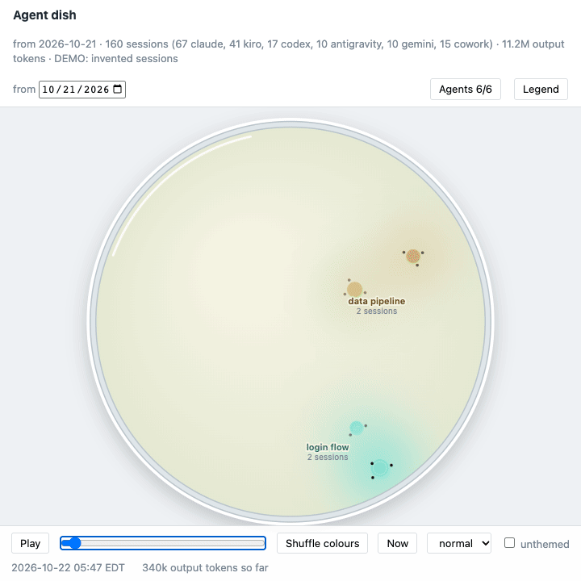
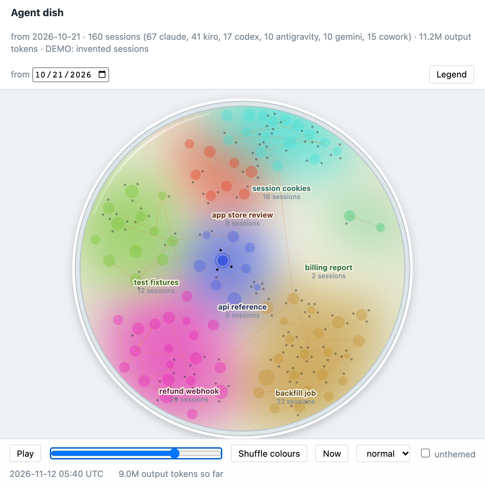
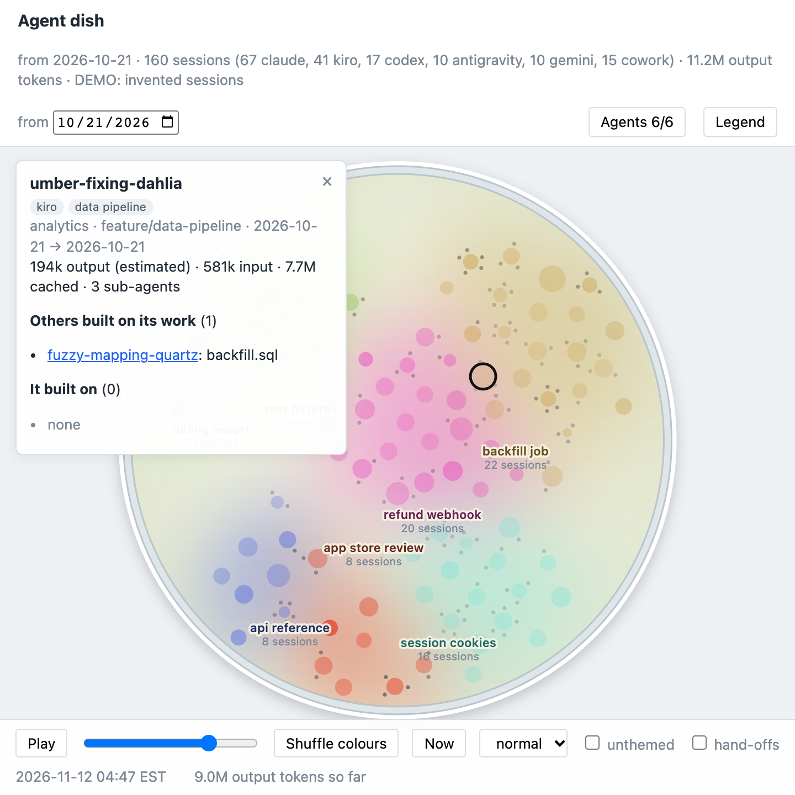
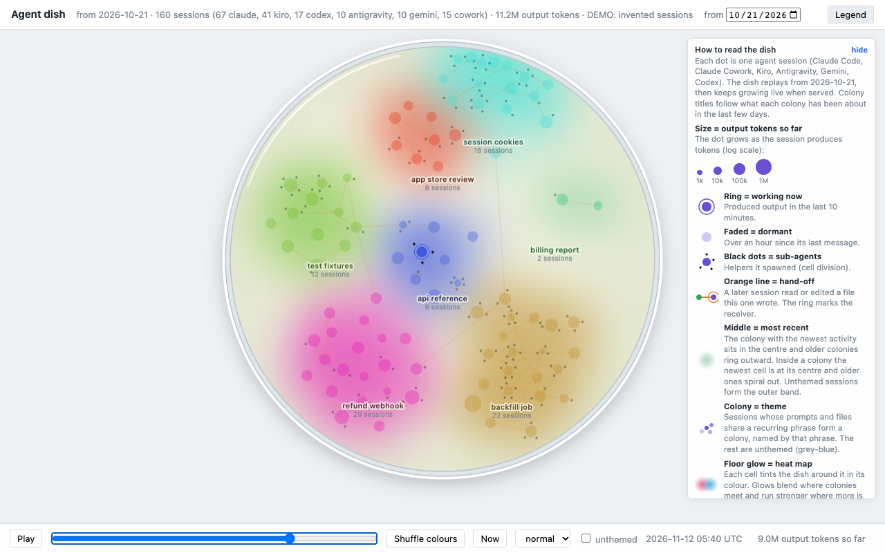

# agent-dish

**Let's cultivate your AI agents.**

<p align="center">
  
</p>
<p align="center"><sub>Invented demo data. Run <code>agent-dish demo --open</code> to play with it yourself.</sub></p>

Every session you run with an AI agent is a cell. It appears when the session starts, grows as it produces tokens,
buds a small dot for every sub-agent it spawns, and fades when it goes quiet. Sessions whose prompts and files keep
returning to the same phrase gather into a colony, named by that phrase. The colony's title moves on as the work does.
Press play to replay your last month, or leave it running and watch the dish grow live.

It reads the transcripts your agents already write on your machine. Nothing is uploaded.

## Cultivate

```bash
pipx install git+https://github.com/kamingfung/agent-dish    # or: pip install git+https://github.com/kamingfung/agent-dish

agent-dish demo --open       # try it first, on invented sessions
agent-dish serve --open      # your own dish, live, last 30 days
```

Python 3.9 or newer, standard library only.

## What you get

<table>
<tr>
<td width="50%"><br><sub><b>The dish.</b> Each colour is a colony. The glow underneath is a heat map of where work clusters. The colony with the newest activity sits in the middle.</sub></td>
<td width="50%"><br><sub><b>One session.</b> Click a cell for its agent, tokens, and what it built on or what later built on it.</sub></td>
</tr>
<tr>
<td colspan="2"><br><sub><b>Built-in legend.</b> Size is tokens so far, a ring means working now, black dots are sub-agents, an orange line is a hand-off.</sub></td>
</tr>
</table>

Use it to see:

- which pieces of work are alive right now, and which went quiet,
- what themes your sessions fall into, and how each one drifts over weeks,
- which sessions other sessions built on (a later session read or edited a file an earlier one wrote).

## Supported agents

| Agent                                                 | Where it reads                                                   | Status                                                                                                                                               |
| ----------------------------------------------------- | ---------------------------------------------------------------- | ---------------------------------------------------------------------------------------------------------------------------------------------------- |
| Claude Code                                           | `~/.claude/projects`                                             | Checked against real sessions. Tokens as reported.                                                                                                   |
| Claude Cowork (Claude Desktop agent mode, non-coding) | `~/Library/Application Support/Claude/local-agent-mode-sessions` | Checked against real sessions. Same transcript format as Claude Code.                                                                                |
| Kiro                                                  | `~/.kiro/sessions`                                               | Checked against real sessions. Kiro records no token counts, so sizes are estimated as characters / 4 and are only comparable between Kiro sessions. |
| Antigravity (`agy`)                                   | `~/.gemini/antigravity-cli`                                      | Checked on a small number of real sessions. Tokens as reported.                                                                                      |
| Gemini CLI                                            | `~/.gemini/tmp/*/chats`                                          | **Experimental.** Written from the chat-recording format and tested on a synthetic fixture only.                                                     |
| Codex                                                 | `~/.codex/sessions`                                              | **Experimental.** Written from the documented rollout format and tested on a synthetic fixture only.                                                 |

If an experimental agent misbehaves, please open an issue with a redacted sample. Each location can be overridden with an
environment variable (`AGENT_DISH_CLAUDE_ROOT`, `..._COWORK_ROOT`, `..._KIRO_ROOT`, `..._ANTIGRAVITY_ROOT`,
`..._GEMINI_ROOT`, `..._CODEX_ROOT`). Adding another agent is one small file:
[docs/adding-an-agent.md](https://github.com/kamingfung/agent-dish/blob/main/docs/adding-an-agent.md).

## Use

```bash
agent-dish serve --open                 # live dish at http://127.0.0.1:8765, last 30 days
agent-dish serve --since 2026-10-01     # start from a date instead (you can also pick one in the page)
agent-dish serve --agents claude,kiro   # only some agents
agent-dish build --out .                # one self-contained agent-dish.html snapshot
agent-dish agents                       # which agents' sessions were found on this machine
agent-dish demo --open                  # invented sessions, nothing from your machine
```

The first run reads every transcript in the window (about 15 seconds for a thousand). After that only transcripts that
changed are re-read, so live updates take about a second.

How to read what you see: [docs/how-to-read.md](https://github.com/kamingfung/agent-dish/blob/main/docs/how-to-read.md), or press **Legend** in the page.

## What it can and cannot tell you

- A hand-off means only that a later session read or edited the same file path. Work shared through git, pull requests
  or documents is invisible to transcripts, so treat hand-offs as a lower bound.
- Colony names are the top recurring phrase in a group's prompts, branch names and file paths. They are a rough guide,
  and many sessions (automated ones especially) have no recurring phrase and stay "unthemed", which is hidden by default.
- Token counts are only as good as what each agent records.

## Privacy

Transcripts can contain private code and prompts. agent-dish reads them locally, keeps prompt text in memory only to find
recurring phrases, and writes just the phrases. Its output (`graph.json`, the HTML snapshot and the cache in
`~/.cache/agent-dish`, override with `AGENT_DISH_HOME`) still contains file paths, session names, branch names and those
phrases. Do not publish or share it without looking at it first. The server binds to `127.0.0.1` only. The pictures in this
README come from `agent-dish demo`, which is invented.

## Development

```bash
just setup    # uv sync, and the git hooks (pre-commit)
just check    # lint, formatting, tests, secret and personal-info scans: what CI runs
just --list   # every recipe
```

The pre-commit hooks and CI block credentials (gitleaks), private keys, large files, home-directory paths, email addresses
and a private list of your own terms, so the repository stays free of secrets and personal information. The tests use
synthetic transcripts, never real data. The README images are regenerated by
[scripts/make_media.cjs](https://github.com/kamingfung/agent-dish/blob/main/scripts/make_media.cjs) from the demo dish.
See [CONTRIBUTING.md](https://github.com/kamingfung/agent-dish/blob/main/CONTRIBUTING.md).

## Let's cultivate your AI agents

```bash
pipx install git+https://github.com/kamingfung/agent-dish && agent-dish serve --open
```

## License

MIT
